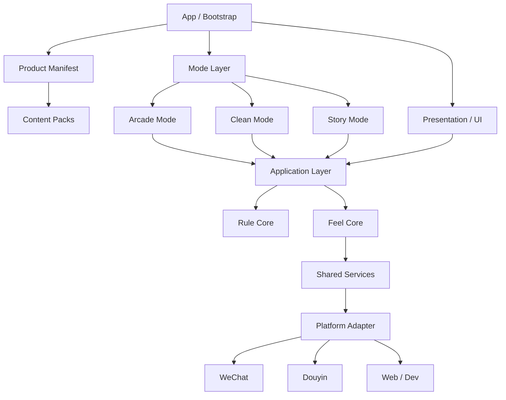
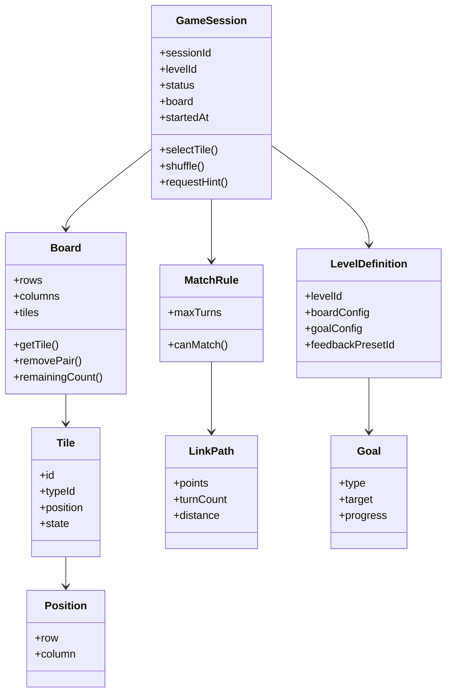
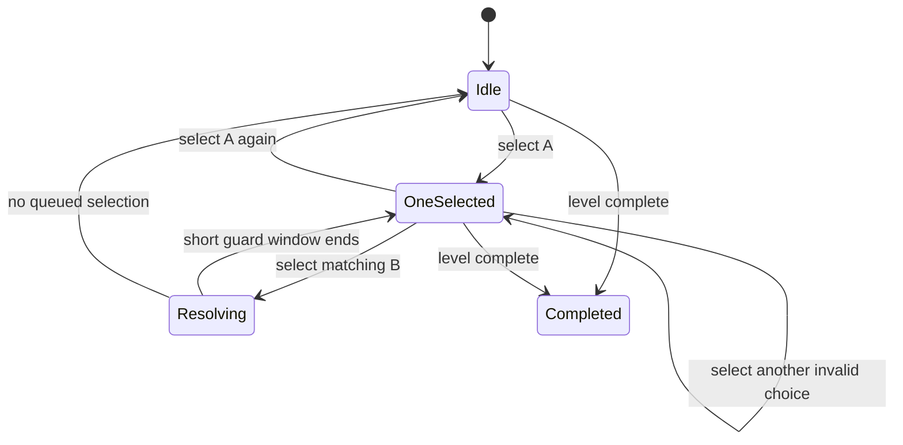

# 连连看小游戏技术设计文档 V1.0

> 文档状态：可用于第一阶段开发  
> 日期：2026-10-28  
> 核心目标：构建一套可被「快爽」「清理解压」「剧情换皮」三类产品共同复用的连连看游戏底座，并以最低边际成本持续扩展内容和产品形态。

---

## 0. 文档结论

第一阶段采用：

**一个代码仓库 + 一个 Cocos Creator 工程 + 一套 Link Core + 三个 Mode + 多套 Content Pack + 多产品构建配置。**

三类产品不分别开发三套连连看。

统一结构为：

```text
Link Core
├── Rule Core    规则正确
└── Feel Core    操作够爽
        │
        ▼
Mode Layer
├── Arcade       快爽
├── Clean        清理解压
└── Story        剧情换皮
        │
        ▼
Content Layer
├── 具体关卡
├── 具体场景
├── 具体剧情
└── 具体素材
```

核心设计原则：

> 三种产品共享相同的连连看基础品质，差异主要发生在「消除之外」。

快爽产品强调高频打击、Combo、挑战与单位时间爽感密度。

清理产品强调场景从脏乱到整洁的恢复过程。它可以整体节奏更舒缓，但单次点击、连接、命中、消除必须依然快速、干脆。

剧情产品强调剧情推进、角色、装修或轻经营。连连看承担节奏转换、参与感和奖励触发器的作用，不应成为阻碍玩家看剧情的高门槛关卡。

---

# 1. 项目目标

## 1.1 第一阶段目标

V1 要解决五件事：

1. 建立稳定、可测试、可复用的连连看规则内核。
2. 建立统一的操作手感与强反馈系统。
3. 支持快爽、清理、剧情三类 Mode 复用同一套 Link Core。
4. 关卡、反馈参数和大部分内容数据配置化。
5. 支持同一个工程构建出不同产品变体。

V1 的成功标准不是“做出完整商业游戏”，而是：

> 能用同一套核心代码快速做出三种明显不同的产品体验，并证明基础连连看本身足够爽。

---

## 1.2 产品级目标

### 快爽产品

核心情绪：

```text
快 → 准 → 爆 → 连 → 更快
```

重点：

- 输入响应快
- 连线反馈快
- 消除反馈强
- Combo 连续升级
- 失败/重开成本低
- 单局短
- 重复游玩意愿高

### 清理解压产品

核心情绪：

```text
脏乱 → 清理 → 恢复 → 完成
```

重点：

- 连连看操作仍然快
- 整体节奏允许慢
- 强调清洁进度
- 强调阶段变化
- 强调 Before / After
- 强调完成感，而非高难挑战

### 剧情产品

核心情绪：

```text
剧情悬念 → 参与 → 奖励 → 下一段剧情
```

重点：

- 关卡短
- 难度低阻力
- 剧情推进快
- 内容替换成本低
- 人物、背景、文本、装修物等高度配置化

---

# 2. 非目标与架构边界

## 2.1 V1 明确不做

V1 不建设以下系统：

- 万能游戏引擎
- 可视化关卡编辑器
- 自研脚本语言 / DSL
- 自研热更新框架
- 大型 ECS
- 通用剧情编辑器
- 通用商业化后台
- 通用运营后台
- 完整实时后端
- MMO 式账号体系
- 跨产品复杂社交关系
- 为“以后可能会用”而开发的抽象层

原则：

```text
三个产品都会用 → Core

两个以上产品明确会用 → Framework / Shared

只有一个产品使用 → Mode

仅仅“以后可能会用” → 现在不开发
```

---

## 2.2 Link Core 的边界

Link Core 只负责：

```text
“玩家如何完成一次高质量的连连看交互。”
```

它不知道：

- 当前是不是在清理鸡圈
- 当前剧情人物是谁
- 当前章节是什么
- 玩家有没有装修房子
- 玩家为什么获得金币
- 玩家有没有看广告

Link Core 可以产生事件：

```text
MatchSucceeded
PairRemoved
BoardCleared
ComboChanged
```

外部 Mode 根据这些事件决定业务含义。

例如：

```text
PairRemoved
    │
    ├── ArcadeMode → Combo + Score
    ├── CleanMode  → CleanProgress +2%
    └── StoryMode  → ObjectiveProgress +1
```

---

# 3. 总体设计理念

## 3.1 Rule Core 与 Feel Core 同等重要

基础连连看拆成两个核心域：

```text
LinkGameCore
├── RuleCore
└── FeelCore
```

### Rule Core

解决：

> 游戏规则是否正确。

负责：

- 棋盘
- 棋子
- 匹配
- 连线路径
- 消除
- 洗牌
- 提示
- 死局
- 棋盘生成
- 关卡目标的基础事件

### Feel Core

解决：

> 游戏是否“啪一下很爽，还想再点一次”。

负责：

- 点击反馈
- 选中反馈
- 连线表现
- 命中反馈
- Hit Stop
- Squash / Stretch
- 破碎动画
- 粒子
- 屏幕微震
- 音效
- 手机震动
- Combo 节奏反馈

---

## 3.2 “逻辑立即结算，表现异步播放”

这是 V1 的关键技术规范。

错误做法：

```text
匹配成功
↓
等待连线动画
↓
等待爆炸
↓
等待粒子
↓
删除棋子
↓
恢复输入
```

这会使操作非常黏。

正确做法：

```text
匹配成功
↓
逻辑立即标记棋子为 Removed / Resolving
↓
立即更新 Board State
↓
发出 MatchResolved 事件
├── View 播放连线
├── View 播放爆炸
├── Audio 播放声音
├── Haptic 震动
├── Mode 更新进度
└── 输入系统在极短保护窗口后继续接受输入
```

原则：

> 动画不能成为核心逻辑锁。

允许上一组棋子的爆炸动画还未结束时，玩家已经开始操作下一组棋子。

---

## 3.3 配置优先，代码负责规则

以下内容尽量配置化：

- 棋盘大小
- Tile 类型数量
- 时间限制
- 目标
- 提示次数
- 洗牌次数
- FeedbackPreset
- 清洁阶段
- 剧情节点
- 奖励
- 素材映射
- 产品入口

但配置不承担复杂业务逻辑。

不要在 JSON 中创造第二套编程语言。

---

## 3.4 依赖方向必须单向

依赖必须满足：

```text
Content
   ↓
Mode
   ↓
Application
   ↓
Domain
```

表现层和平台层通过接口接入。

Domain 禁止依赖：

```text
Cocos Node
Sprite
AudioSource
Platform API
广告 SDK
微信 API
抖音 API
```

这样规则核心才能独立测试。

---

# 4. 技术选型

## 4.1 客户端

| 项目 | 选型 |
|---|---|
| 游戏引擎 | Cocos Creator 3.8 LTS |
| 开发语言 | TypeScript |
| 主要形态 | 2D 竖屏小游戏 |
| UI | Cocos UI / Prefab / Node |
| 动画 | Animation + Tween |
| 粒子 | Cocos ParticleSystem2D / 自定义轻量特效 |
| 音频 | AudioSource + 自研 AudioService |
| 配置 | JSON |
| 资源管理 | Cocos Asset Bundle + ResourceService |
| 状态管理 | 轻量 FSM + Typed Event Bus |
| 单元测试 | 对纯 TypeScript Domain 使用 Vitest 等独立测试工具 |
| 代码质量 | ESLint + Prettier |
| 版本管理 | Git |
| 包管理 | pnpm，仅用于开发工具和仓库脚本 |
| 构建 | Cocos Build + 产品 Manifest |
| 首发目标 | 优先验证小游戏平台，平台 API 通过 Adapter 隔离 |

---

## 4.2 为什么不优先 Unity

本项目目前主要是：

- 2D
- 轻量
- 小游戏
- 快速迭代
- 快速换皮
- 多平台小游戏发布

因此 V1 没有必要为 Unity 的更重运行时和工程复杂度付出成本。

如果以后产品演化成：

- 重 3D
- 大世界
- 大量 Shader
- 重物理
- Native App 为核心

再重新评估。

---

## 4.3 后端策略

V1：

> 不为了“架构完整”提前建设独立游戏后端。

第一阶段允许：

```text
本地存档
+
平台云能力
+
分析平台
+
平台广告 SDK
```

但所有能力必须通过接口访问：

```text
ISaveService
IAnalyticsService
IAdService
IPlatformService
IRemoteConfigService
```

业务代码禁止直接调用：

```text
wx.xxx()
tt.xxx()
```

以后从微信切抖音、从平台云切独立后端时，不需要修改 Mode 和 Link Core。

---

# 5. 总体架构



---

# 6. 分层架构

## 6.1 Domain

纯业务规则。

不得 import `cc`。

包含：

```text
Board
Tile
Position
LinkPath
MatchRule
PathFinder
DeadlockDetector
BoardGenerator
GameSession
Goal
```

要求：

- deterministic
- 可测试
- 无场景对象
- 无 UI
- 无 SDK

---

## 6.2 Application

负责组织一次游戏流程。

例如：

```text
StartLevelUseCase
SelectTileUseCase
RequestHintUseCase
ShuffleBoardUseCase
PauseGameUseCase
CompleteLevelUseCase
```

Application 不负责画动画。

---

## 6.3 Feel

把 Domain Event 转化为表现行为。

例如：

```text
MatchSucceeded
↓
FeedbackDirector
├── LinkLineEffect
├── TileHitEffect
├── TileBreakEffect
├── ScreenShake
├── Audio
└── Haptic
```

---

## 6.4 Mode

负责产品差异。

```text
ArcadeMode
CleanMode
StoryMode
```

每个 Mode 只订阅 Link Core 事件，不复制 Link Core。

---

## 6.5 Presentation

负责：

- 主界面
- 棋盘 View
- Tile View
- HUD
- Result
- Dialog
- Progress
- Story UI

Presentation 不计算连线是否合法。

---

## 6.6 Infrastructure

负责：

- Save
- Analytics
- Ads
- Platform
- Remote Config
- Asset
- Audio
- Log

---

# 7. 领域模型

## 7.1 核心 Aggregate



---

## 7.2 Tile

```ts
export type TileState =
  | 'idle'
  | 'selected'
  | 'resolving'
  | 'removed';

export interface Tile {
  id: string;
  typeId: string;
  position: Position;
  state: TileState;
}
```

注意：

`resolving` 是必要状态。

匹配成功后立即进入 resolving，防止同一棋子在动画过程中再次被选择。

---

## 7.3 Board

```ts
export interface BoardState {
  rows: number;
  columns: number;
  cells: Array<Tile | null>;
}
```

推荐内部使用一维数组：

```text
index = row * columns + column
```

优点：

- 数据连续
- Snapshot 简单
- 序列化简单
- 单元测试方便

View 层再映射为二维位置。

---

## 7.4 LinkPath

```ts
export interface Position {
  row: number;
  col: number;
}

export interface LinkPath {
  points: Position[];
  turns: number;
  distance: number;
}
```

原则：

> Rule Core 只返回路径坐标，不生成 LineRenderer。

---

# 8. 连线算法设计

## 8.1 V1 规则

默认经典规则：

- 两个 Tile `typeId` 相同
- 两个位置不同
- 路径只能通过空格
- 最多允许 2 次转折
- 可允许路径经过棋盘外一圈

---

## 8.2 推荐算法

V1 使用：

> 带方向状态的 BFS。

搜索状态：

```ts
interface SearchState {
  pos: Position;
  direction: Direction;
  turns: number;
  distance: number;
}
```

约束：

```text
turns <= maxTurns
```

排序优先级：

```text
更少转折
→
更短路径
```

原因：

- 实现稳定
- 容易单测
- 支持以后修改 maxTurns
- 支持障碍物
- 支持特殊 Tile
- 不需要为 0/1/2 折分别维护大量分支

---

## 8.3 棋盘边界

逻辑棋盘建议自动增加一圈虚拟空白：

```text
原始：

A X X X
X X X B

逻辑：

. . . . . .
. A X X X .
. X X X B .
. . . . . .
```

从而自然支持“从棋盘外围绕过去”。

---

# 9. Board Generator

## 9.1 V1 生成方式

```text
确定 pairCount
↓
生成成对 typeId
↓
随机打乱
↓
填入可用 Cell
↓
检测是否至少存在一个可消除 Pair
↓
如果不存在 → Shuffle
```

V1 不要求生成器保证：

> 从第一步开始存在唯一的、无需洗牌即可完整解完的数学解。

因为这会明显增加实现复杂度。

V1 使用：

```text
DeadlockDetector + Shuffle
```

保证玩家不会被永久卡死。

---

## 9.2 Deadlock

每次 PairRemoved 后：

```text
remaining == 0
→ BoardCleared

remaining > 0
→ hasAvailableMatch()

false
→ DeadlockDetected
→ AutoShuffle
```

---

# 10. 输入系统

## 10.1 输入流程



---

## 10.2 快速操作规范

禁止：

```text
为了等完整动画而锁输入 300~800ms
```

建议：

- 逻辑结算立即完成
- 只保留很短的防误触窗口
- 动画并发
- Resolving Tile 不再接收输入
- 其他 Tile 可以尽快继续操作

第一版建议调参起点：

| 参数 | 初始值 |
|---|---:|
| 点击缩放反馈 | 60~90ms |
| 连线出现 | 60~100ms |
| Hit Stop | 30~50ms |
| Break 主动画 | 120~180ms |
| 输入保护窗口 | 50~80ms |
| 屏幕震动 | 40~90ms |

以上不是硬编码标准，必须放入 FeedbackPreset。

---

# 11. Feel Core

## 11.1 Feedback Pipeline

每次成功消除：

```text
Select
↓
Lock
↓
Link
↓
Hit
↓
Break
↓
Reward
```

对应模块：

```text
SelectionFeedback
LinkFeedback
HitFeedback
BreakFeedback
AudioFeedback
CameraFeedback
HapticFeedback
ComboFeedback
```

---

## 11.2 FeedbackDirector

```ts
export interface MatchFeedbackContext {
  tileA: string;
  tileB: string;
  path: LinkPath;
  combo: number;
  preset: FeedbackPreset;
}

export interface IFeedbackDirector {
  playMatch(context: MatchFeedbackContext): void;
  playMismatch(): void;
  playHint(tileIds: [string, string]): void;
}
```

---

## 11.3 FeedbackPreset

```ts
export interface FeedbackPreset {
  id: string;

  selectionScale: number;
  selectionDurationMs: number;

  linkDurationMs: number;

  hitStopMs: number;
  tileShakeStrength: number;

  breakDurationMs: number;
  particleLevel: number;

  cameraShakeStrength: number;
  cameraShakeDurationMs: number;

  hapticLevel: 'off' | 'light' | 'medium';

  comboPitchStep: number;
  comboMaxPitch: number;
}
```

示例：

```json
{
  "id": "arcade_default",
  "selectionScale": 1.08,
  "selectionDurationMs": 70,
  "linkDurationMs": 70,
  "hitStopMs": 45,
  "tileShakeStrength": 1.0,
  "breakDurationMs": 140,
  "particleLevel": 3,
  "cameraShakeStrength": 0.8,
  "cameraShakeDurationMs": 60,
  "hapticLevel": "medium",
  "comboPitchStep": 0.04,
  "comboMaxPitch": 1.4
}
```

---

## 11.4 三产品 Preset

### Arcade

```text
高速度
高打击
高 Combo
中等震屏
更多粒子
更明显音高递增
```

### Clean

```text
操作仍快
Hit Stop 中等
震屏低
粒子更柔和
强化清洁完成反馈
弱化竞技感
```

### Story

```text
操作快
震屏较低
单次奖励反馈较强
强化剧情资源获得
避免特效抢剧情注意力
```

---

# 12. Mode 接口

```ts
export interface GameMode {
  readonly id: string;

  initialize(context: ModeContext): Promise<void>;

  onSessionStart(): void;

  onMatchResolved(event: MatchResolvedEvent): void;

  onBoardCleared(): void;

  evaluateResult(): ModeResult;

  dispose(): void;
}
```

Mode 不允许：

```text
自己重新计算 LinkPath
自己维护另一套 Board
自己删除 Tile
```

---

# 13. Arcade Mode

## 13.1 职责

```text
Timer
Score
Combo
Fever
DifficultyCurve
LevelResult
```

---

## 13.2 Combo

推荐把 Combo 做成 Arcade Mode 的主要系统，而不是 Rule Core 的硬规则。

```ts
export interface ComboState {
  count: number;
  maxCount: number;
  lastMatchAt: number;
}
```

例如：

```text
成功消除
↓
在 ComboWindow 内继续成功
↓
Combo +1
```

Rule Core 只发：

```text
MatchResolved
```

ArcadeMode 决定是否算 Combo。

---

# 14. Clean Mode

## 14.1 核心模型

```text
CleanScenario
├── ScenarioBackground
├── CleanStages
├── Progress
└── CompletionEffect
```

---

## 14.2 CleanScenario

```ts
export interface CleanScenario {
  id: string;
  levelId: string;

  stages: CleanStage[];

  progressPerPair: number;
}

export interface CleanStage {
  threshold: number;
  visualStateId: string;
  transitionEffectId?: string;
}
```

示例：

```json
{
  "id": "farm_chicken_house_001",
  "levelId": "clean_001",
  "progressPerPair": 2,
  "stages": [
    {
      "threshold": 0,
      "visualStateId": "dirty_100"
    },
    {
      "threshold": 25,
      "visualStateId": "dirty_75"
    },
    {
      "threshold": 50,
      "visualStateId": "dirty_50"
    },
    {
      "threshold": 75,
      "visualStateId": "dirty_25"
    },
    {
      "threshold": 100,
      "visualStateId": "clean"
    }
  ]
}
```

---

## 14.3 清理节奏原则

清理模式的“慢”来自：

```text
场景变化
观察
恢复
完成过程
```

而不是来自：

```text
慢点击
慢响应
慢消失
输入锁
```

因此：

> Clean Mode 可以慢，Link Core 不可以迟钝。

---

# 15. Story Mode

## 15.1 核心模型

```text
StoryCampaign
└── Chapter
    └── StoryNode
        ├── Dialogue
        ├── Game
        ├── Reward
        ├── Choice
        └── Decoration
```

---

## 15.2 StoryNode

```ts
export type StoryNodeType =
  | 'dialogue'
  | 'game'
  | 'reward'
  | 'choice'
  | 'decoration';

export interface StoryNode {
  id: string;
  type: StoryNodeType;
  next?: string;
  payload: unknown;
}
```

---

## 15.3 剧情配置示例

```json
{
  "chapterId": "chapter_001",
  "startNode": "n001",
  "nodes": [
    {
      "id": "n001",
      "type": "dialogue",
      "next": "n002",
      "payload": {
        "speaker": "mother",
        "text": "你终于回来了。",
        "portrait": "mother_normal"
      }
    },
    {
      "id": "n002",
      "type": "game",
      "next": "n003",
      "payload": {
        "levelId": "story_level_001"
      }
    },
    {
      "id": "n003",
      "type": "reward",
      "payload": {
        "items": [
          {
            "id": "coin",
            "count": 100
          }
        ]
      }
    }
  ]
}
```

---

## 15.4 Story Mode 原则

剧情游戏里的连连看默认应该：

- 短局
- 低阻力
- 快奖励
- 快失败恢复
- 少重复劳动

建议第一阶段目标：

```text
一个剧情玩法节点约 30~90 秒
```

具体数值后续通过测试调整。

---

# 16. Level System

## 16.1 LevelDefinition

```ts
export interface LevelDefinition {
  schemaVersion: number;

  id: string;
  mode: 'arcade' | 'clean' | 'story';

  board: BoardConfig;

  rule: MatchRuleConfig;

  goal: GoalConfig;

  feedbackPresetId: string;

  assists?: AssistConfig;

  metadata?: Record<string, unknown>;
}
```

---

## 16.2 BoardConfig

```ts
export interface BoardConfig {
  rows: number;
  columns: number;

  tileSetId: string;

  pairCount: number;

  emptyCells?: Position[];

  generator: 'random-pairs' | 'fixed';
}
```

---

## 16.3 MatchRuleConfig

```ts
export interface MatchRuleConfig {
  maxTurns: number;
  allowOuterPath: boolean;
}
```

---

## 16.4 GoalConfig

```ts
export type GoalConfig =
  | {
      type: 'clear-board';
    }
  | {
      type: 'score';
      target: number;
    }
  | {
      type: 'time';
      seconds: number;
    }
  | {
      type: 'clean-progress';
      target: number;
    }
  | {
      type: 'collect';
      target: number;
      tileTypeId: string;
    };
```

---

# 17. Product Manifest

三个产品不复制工程。

使用 Product Manifest 决定构建内容。

```ts
export interface ProductManifest {
  productId: string;

  mode: 'arcade' | 'clean' | 'story';

  defaultFeedbackPresetId: string;

  contentPacks: string[];

  features: {
    ads: boolean;
    analytics: boolean;
    cloudSave: boolean;
  };
}
```

示例：

```json
{
  "productId": "bibabo-clean",
  "mode": "clean",
  "defaultFeedbackPresetId": "clean_default",
  "contentPacks": [
    "common",
    "clean-core",
    "farm-season-01"
  ],
  "features": {
    "ads": true,
    "analytics": true,
    "cloudSave": true
  }
}
```

---

# 18. Content Pack

内容与代码分离。

```text
ContentPack
├── manifest
├── config
├── sprites
├── audio
├── effects
└── localization
```

例如：

```text
farm-season-01
├── manifest.json
├── levels
│   ├── 001.json
│   ├── 002.json
│   └── 003.json
├── scenarios
│   ├── chicken-house.json
│   └── pig-house.json
├── sprites
├── audio
└── effects
```

目标：

以后做：

```text
农场
洗车
厨房
修牛蹄
整理冰箱
```

尽量只新增 Content Pack，而不是复制代码。

---

# 19. 事件系统

## 19.1 原则

禁止大量使用：

```ts
emit("xxx")
```

字符串事件。

使用强类型事件。

---

## 19.2 DomainEvent

```ts
export type GameEvent =
  | TileSelectedEvent
  | MatchResolvedEvent
  | MatchFailedEvent
  | PairRemovedEvent
  | DeadlockDetectedEvent
  | BoardShuffledEvent
  | BoardClearedEvent
  | GoalProgressChangedEvent
  | LevelCompletedEvent
  | LevelFailedEvent;
```

---

## 19.3 MatchResolvedEvent

```ts
export interface MatchResolvedEvent {
  type: 'match-resolved';

  tileAId: string;
  tileBId: string;

  tileTypeId: string;

  path: LinkPath;

  timestamp: number;
}
```

---

## 19.4 Event Bus 使用规则

Event Bus 用于：

```text
跨模块通知
```

不要用于：

```text
所有函数调用
```

能直接调用的内部逻辑继续直接调用。

否则系统会变成无法追踪的数据流。

---

# 20. Game Session

每一局创建独立 Session。

```ts
export interface GameSessionState {
  sessionId: string;

  levelId: string;

  status:
    | 'loading'
    | 'playing'
    | 'paused'
    | 'completed'
    | 'failed';

  board: BoardState;

  startedAt: number;

  elapsedMs: number;
}
```

不要把一局游戏状态散落到多个 Singleton 中。

---

# 21. 状态机

## 21.1 App State

```text
Bootstrap
↓
Home
↓
LoadingLevel
↓
Playing
↓
Result
↓
Home / NextLevel
```

---

## 21.2 Session State

```text
Loading
↓
Playing
├── Paused
├── Completed
└── Failed
```

---

## 21.3 禁止

禁止使用大量：

```ts
if (isPlaying && !isPaused && !isLoading && !isResult...)
```

替代状态机。

---

# 22. Service 设计

## 22.1 Save

```ts
export interface ISaveService {
  load<T>(key: string): Promise<T | null>;

  save<T>(key: string, value: T): Promise<void>;

  remove(key: string): Promise<void>;
}
```

实现：

```text
LocalSaveService
WeChatSaveService
DouyinSaveService
FutureCloudSaveService
```

---

## 22.2 Analytics

```ts
export interface IAnalyticsService {
  track(
    eventName: string,
    params?: Record<string, string | number | boolean>
  ): void;
}
```

---

## 22.3 Ads

```ts
export interface IAdService {
  showRewardedVideo(
    placementId: string
  ): Promise<'completed' | 'skipped' | 'failed'>;

  showInterstitial(
    placementId: string
  ): Promise<void>;
}
```

Mode 不允许知道具体广告 SDK。

---

## 22.4 Platform

```ts
export interface IPlatformService {
  getPlatform(): 'web' | 'wechat' | 'douyin';

  vibrate(
    level: 'light' | 'medium' | 'heavy'
  ): void;

  share?(payload: SharePayload): Promise<void>;
}
```

---

# 23. Analytics 事件规范

V1 至少记录：

```text
app_start

level_start
level_complete
level_fail
level_quit

tile_select
match_success
match_fail

hint_use
shuffle_trigger

deadlock

ad_request
ad_complete
ad_skip
ad_fail
```

快爽额外：

```text
combo_reach
fever_start
fever_end
```

清理额外：

```text
clean_stage_enter
clean_complete
```

剧情额外：

```text
story_node_enter
story_node_complete
chapter_complete
choice_selected
```

---

## 23.1 必须携带公共字段

```text
product_id
build_version
content_version
session_id
level_id
mode
platform
```

---

## 23.2 埋点边界

埋点失败：

> 绝不能阻塞游戏流程。

所有 Analytics 调用必须 fire-and-forget 或异步降级。

---

# 24. 存档模型

V1 推荐：

```ts
export interface PlayerSave {
  schemaVersion: number;

  player: {
    createdAt: number;
    lastLoginAt: number;
  };

  progress: {
    currentLevelId?: string;
    completedLevels: string[];
  };

  settings: {
    sound: boolean;
    music: boolean;
    haptic: boolean;
  };

  modeData: Record<string, unknown>;
}
```

---

## 24.1 Save Migration

任何持久化数据都必须带：

```text
schemaVersion
```

禁止假设旧存档永远兼容。

```ts
export interface SaveMigration {
  from: number;
  to: number;
  migrate(input: unknown): unknown;
}
```

---

# 25. Resource / Asset 设计

## 25.1 资源原则

禁止：

```text
业务代码里写大量固定资源路径
```

推荐：

```text
ResourceId
↓
ResourceCatalog
↓
Asset Bundle
↓
Asset
```

---

## 25.2 ResourceCatalog

```json
{
  "tile.cat": "common/tiles/cat",
  "tile.dog": "common/tiles/dog",
  "fx.match.default": "common/fx/match_default",
  "audio.match.01": "common/audio/match_01"
}
```

---

## 25.3 Bundle

建议：

```text
common
arcade-core
clean-core
story-core

farm-season-01
story-season-01
```

首包只加载必要资源。

后续内容按 Bundle 加载。

---

# 26. Audio 设计

不允许各组件自己随意播放声音。

统一：

```ts
export interface IAudioService {
  playSfx(id: string, options?: SfxOptions): void;

  playMusic(id: string): void;

  stopMusic(): void;
}
```

Combo 音高变化统一由：

```text
ComboAudioController
```

处理。

---

# 27. UI 设计原则

V1 UI 采用：

```text
Scene
└── Canvas
    ├── ScreenRoot
    ├── GameRoot
    │   ├── Board
    │   ├── EffectLayer
    │   └── HUD
    ├── Overlay
    └── DebugLayer
```

EffectLayer 必须独立。

原因：

- 粒子不污染 Tile 节点
- 方便对象池
- 方便统一控制渲染层级

---

# 28. 对象池

以下对象建议池化：

```text
TileView
LinkEffect
BreakParticle
FloatingText
ComboText
```

原则：

> 高频对象禁止在每次消除时反复 instantiate / destroy。

---

# 29. 性能目标

第一阶段基准目标：

| 指标 | 目标 |
|---|---|
| 目标帧率 | 主流设备稳定 60 FPS |
| 游戏过程中长 GC 卡顿 | 不允许明显出现 |
| Tile 高频创建销毁 | 使用对象池 |
| 每帧路径搜索 | 禁止 |
| Match Path 计算 | 只在玩家选择第二个 Tile 时执行 |
| 死局检测 | PairRemoved 后执行，不放 update |
| Analytics | 不阻塞主线程游戏流程 |
| 资源加载 | 关卡开始前完成必要资源加载 |

---

# 30. 文件目录设计

第一阶段推荐保持一个 Cocos 工程。

```text
bibabo-game/
│
├── assets/
│   │
│   ├── app/
│   │   ├── Bootstrap.ts
│   │   ├── App.ts
│   │   └── ProductContext.ts
│   │
│   ├── core/
│   │   │
│   │   ├── domain/
│   │   │   ├── board/
│   │   │   │   ├── Board.ts
│   │   │   │   ├── BoardState.ts
│   │   │   │   ├── BoardGenerator.ts
│   │   │   │   └── DeadlockDetector.ts
│   │   │   │
│   │   │   ├── tile/
│   │   │   │   ├── Tile.ts
│   │   │   │   └── TileState.ts
│   │   │   │
│   │   │   ├── match/
│   │   │   │   ├── MatchRule.ts
│   │   │   │   ├── PathFinder.ts
│   │   │   │   ├── LinkPath.ts
│   │   │   │   └── Position.ts
│   │   │   │
│   │   │   ├── session/
│   │   │   │   ├── GameSession.ts
│   │   │   │   └── GameSessionState.ts
│   │   │   │
│   │   │   └── goal/
│   │   │       ├── Goal.ts
│   │   │       └── GoalFactory.ts
│   │   │
│   │   ├── application/
│   │   │   ├── StartLevelUseCase.ts
│   │   │   ├── SelectTileUseCase.ts
│   │   │   ├── ShuffleUseCase.ts
│   │   │   └── HintUseCase.ts
│   │   │
│   │   ├── events/
│   │   │   ├── GameEvent.ts
│   │   │   └── GameEventBus.ts
│   │   │
│   │   └── feel/
│   │       ├── FeedbackDirector.ts
│   │       ├── FeedbackPreset.ts
│   │       ├── SelectionFeedback.ts
│   │       ├── LinkFeedback.ts
│   │       ├── HitFeedback.ts
│   │       ├── BreakFeedback.ts
│   │       └── CameraFeedback.ts
│   │
│   ├── modes/
│   │   │
│   │   ├── arcade/
│   │   │   ├── ArcadeMode.ts
│   │   │   ├── ComboSystem.ts
│   │   │   ├── ScoreSystem.ts
│   │   │   ├── TimerSystem.ts
│   │   │   └── FeverSystem.ts
│   │   │
│   │   ├── clean/
│   │   │   ├── CleanMode.ts
│   │   │   ├── CleanScenario.ts
│   │   │   ├── CleanProgressSystem.ts
│   │   │   └── CleanStageController.ts
│   │   │
│   │   └── story/
│   │       ├── StoryMode.ts
│   │       ├── StoryCampaign.ts
│   │       ├── StoryNode.ts
│   │       ├── StoryRunner.ts
│   │       └── DecorationSystem.ts
│   │
│   ├── presentation/
│   │   ├── board/
│   │   │   ├── BoardView.ts
│   │   │   ├── TileView.ts
│   │   │   └── LinkLineView.ts
│   │   │
│   │   ├── screens/
│   │   │   ├── HomeScreen.ts
│   │   │   ├── GameScreen.ts
│   │   │   └── ResultScreen.ts
│   │   │
│   │   └── hud/
│   │
│   ├── services/
│   │   ├── save/
│   │   ├── analytics/
│   │   ├── ads/
│   │   ├── audio/
│   │   ├── resource/
│   │   ├── remote-config/
│   │   └── logging/
│   │
│   ├── platform/
│   │   ├── IPlatformService.ts
│   │   ├── WebPlatform.ts
│   │   ├── WeChatPlatform.ts
│   │   └── DouyinPlatform.ts
│   │
│   ├── content/
│   │   ├── common/
│   │   ├── arcade/
│   │   ├── clean/
│   │   └── story/
│   │
│   ├── configs/
│   │   ├── product/
│   │   ├── levels/
│   │   └── feedback/
│   │
│   └── scenes/
│       ├── Bootstrap.scene
│       ├── Home.scene
│       └── Game.scene
│
├── tests/
│   ├── pathfinder/
│   ├── board/
│   ├── deadlock/
│   └── session/
│
├── tools/
│   ├── validate-config/
│   ├── build-product/
│   └── content-check/
│
├── docs/
│   ├── architecture/
│   ├── configs/
│   └── analytics/
│
├── package.json
├── pnpm-lock.yaml
├── .gitignore
└── README.md
```

---

# 31. 依赖约束

必须遵守：

```text
domain
  ↑
application
  ↑
mode
  ↑
presentation
```

Infrastructure 通过 interface 注入。

禁止：

```text
domain → presentation
domain → cocos
domain → ads
domain → platform
domain → mode
```

禁止：

```text
CleanMode import StoryMode
ArcadeMode import CleanMode
```

---

# 32. 编码规范

## 32.1 命名

类：

```text
PascalCase
```

变量 / 函数：

```text
camelCase
```

配置 ID：

```text
snake_case
```

例如：

```text
farm_chicken_house_001
arcade_level_001
feedback_arcade_default
```

---

## 32.2 禁止 Magic Number

错误：

```ts
if (combo > 8) {
}
```

正确：

```ts
if (combo > config.feverComboThreshold) {
}
```

---

## 32.3 Singleton

严格限制 Singleton。

允许：

```text
AppContext
PlatformService
AudioService
AnalyticsService
```

不允许：

```text
Board 单例
GameSession 单例
CleanMode 单例
StoryMode 单例
```

一局游戏必须可以完整销毁。

---

## 32.4 Component 规范

Cocos Component 负责：

```text
节点生命周期
输入转发
View 更新
动画播放
```

不要把复杂 Domain Logic 写在 Component 中。

错误：

```ts
@ccclass
class TileView extends Component {
  onClick() {
    // 在这里直接扫描整个棋盘判断 2 折线路径
  }
}
```

正确：

```text
TileView
↓
SelectTileUseCase
↓
GameSession
↓
PathFinder
```

---

# 33. 配置规范

所有配置必须有：

```text
schemaVersion
id
```

构建前执行：

```text
Config Validator
```

检查：

- ID 重复
- Level 引用不存在
- FeedbackPreset 不存在
- TileSet 不存在
- Story next 节点不存在
- Content Pack 循环引用
- PairCount 非偶数
- Board 容量不足

配置错误应在构建阶段发现，而不是上线后发现。

---

# 34. Debug 能力

V1 必须提供 Debug Panel。

至少支持：

```text
切换关卡
立即完成
立即失败
Shuffle
显示可连线路径
显示 Tile ID
显示 FPS
关闭 / 开启 Feel Effect
切换 FeedbackPreset
设置 Combo
调整游戏速度
```

这是调手感和策划调参的重要基础设施。

---

# 35. 测试策略

## 35.1 Domain 单测

PathFinder 是最高优先级。

必须覆盖：

```text
直线连接
1 折连接
2 折连接
外围连接
被阻挡
不同 Tile
同一个 Tile
超过 2 折
边界
空棋盘
复杂障碍
```

---

## 35.2 Deadlock 测试

覆盖：

```text
有解
无解
只剩一对
多个相同 type
外围可连
```

---

## 35.3 Board 测试

覆盖：

```text
PairCount
Tile 成对
Remove
RemainingCount
Shuffle 后 Tile 数量不变
```

---

## 35.4 Integration Test

至少覆盖：

```text
Start Level
→ Select A
→ Select B
→ Match
→ Remove
→ Goal Progress
→ Board Clear
→ Complete
```

---

# 36. Git 规范

推荐 trunk-based development。

分支：

```text
main
feature/*
fix/*
```

不要长期维护：

```text
arcade_branch
clean_branch
story_branch
```

三个产品依靠：

```text
Product Manifest
```

区分，不依靠永久分支区分。

---

# 37. Build 设计

构建命令建议抽象为：

```bash
pnpm build:arcade
pnpm build:clean
pnpm build:story
```

内部逻辑：

```text
读取 Product Manifest
↓
校验配置
↓
确定 Content Pack
↓
生成 Build Config
↓
调用 Cocos Build
↓
输出产物
```

输出：

```text
dist/
├── arcade/
├── clean/
└── story/
```

平台继续分：

```text
dist/
└── clean/
    ├── wechat/
    ├── douyin/
    └── web/
```

---

# 38. Error Handling

错误分三类：

## Recoverable

例如：

```text
广告加载失败
埋点失败
云存档失败
资源重试
```

原则：

> 降级，不中断游戏。

## Gameplay Error

例如：

```text
死局
```

原则：

> 自动恢复，例如 Shuffle。

## Fatal

例如：

```text
LevelConfig 缺失
必要 Bundle 无法加载
```

原则：

> 中止进入关卡 + 明确日志 + Debug 环境快速暴露。

---

# 39. 日志规范

```ts
logger.debug()
logger.info()
logger.warn()
logger.error()
```

日志必须携带模块：

```text
[PathFinder]
[GameSession]
[CleanMode]
[StoryRunner]
[AdService]
```

生产环境关闭高频 debug 日志。

---

# 40. 安全与合规边界

Core 不保存用户敏感信息。

业务层不要把：

```text
手机号
身份证
真实姓名
```

写入通用 Game Save。

用户身份、支付、广告、隐私授权等必须由平台层 / 业务层独立处理。

任何第三方 SDK：

```text
必须封装到 Infrastructure / Platform
```

禁止在 Domain 和 Mode 中直接散落 SDK 调用。

---

# 41. V1 开发顺序

## Phase 1：Rule Core

目标：

```text
纯 TypeScript 连连看可以正确运行
```

开发：

```text
Board
Tile
PathFinder
MatchRule
BoardGenerator
DeadlockDetector
Shuffle
GameSession
```

交付：

> 无美术也可以通过自动测试验证完整规则。

---

## Phase 2：Feel Prototype

目标：

> 先证明基础连连看本身足够爽。

只做：

```text
一个棋盘
一套 Tile
点击
选中
连线
Hit
Break
粒子
音效
震屏
震动
Combo
```

暂时不做：

```text
农场
剧情
装修
正式商业 UI
```

这是第一个真正需要人工体验验收的版本。

---

## Phase 3：Level + Config

开发：

```text
LevelDefinition
FeedbackPreset
ConfigLoader
ConfigValidator
ProductManifest
```

目标：

> 不改代码即可改变棋盘、规则和反馈参数。

---

## Phase 4：Arcade Mode

开发：

```text
Timer
Score
Combo
Fever
Result
```

用于验证：

> Link Core 在极快节奏下是否成立。

---

## Phase 5：Clean Mode

第一场景建议：

```text
清理农场 / 鸡圈
```

开发：

```text
CleanScenario
CleanStage
CleanProgress
Before / After
```

验证：

> 快操作 + 慢体验是否能形成解压感。

---

## Phase 6：Story Mode

第一版只做：

```text
Dialogue
Game Node
Reward Node
Chapter
```

装修系统第一版只做最小模型。

验证：

> 换文案、人物、背景、关卡配置即可换一个题材。

---

## Phase 7：Platform

最后接：

```text
微信
抖音
广告
存档
埋点
分享
```

业务逻辑成熟前，不让平台 SDK 污染核心代码。

---

# 42. 第一阶段 Milestone

## M1 — Rule Core Ready

验收：

```text
100% 核心连线规则可测试
无 Cocos 依赖
无 UI 依赖
```

---

## M2 — Feel Demo Ready

验收：

```text
连续快速消除不卡输入
反馈参数可配置
音效 / 粒子 / Hit Stop / Shake 可独立开关
主观体验达到“连续点下去有爽感”
```

---

## M3 — Arcade Prototype

验收：

```text
可完成一局
有 Timer
有 Combo
有 Score
有 Result
```

---

## M4 — Clean Prototype

验收：

```text
同一 Link Core
清理场景分阶段恢复
完成后有明确 Before / After 满足感
```

---

## M5 — Story Prototype

验收：

```text
Dialogue
→ Link Game
→ Reward
→ Dialogue

完整跑通
```

---

# 43. Definition of Done

一个新功能只有同时满足以下条件才算完成：

```text
功能正确
+
配置合法
+
异常可降级
+
必要埋点存在
+
没有破坏其他 Mode
+
核心逻辑有测试
+
真机没有明显性能问题
```

---

# 44. 第一版必须优先实现的接口

```text
Board
Tile
PathFinder
DeadlockDetector
GameSession

SelectTileUseCase
ShuffleUseCase
HintUseCase

GameEventBus

FeedbackDirector
FeedbackPreset

GameMode

ISaveService
IAnalyticsService
IAdService
IPlatformService
IAudioService
IResourceService
```

其他接口：

> 在真实需求出现后再抽象。

---

# 45. 最重要的十条工程约束

1. 三款产品禁止复制 Link Core。
2. Domain 禁止依赖 Cocos。
3. Mode 禁止自己实现连线算法。
4. 动画禁止成为逻辑锁。
5. 清理模式可以慢，输入响应不能慢。
6. 剧情模式关卡不能成为剧情消费障碍。
7. 配置可以描述数据，不创造万能脚本语言。
8. 微信、抖音等平台 API 必须经过 Adapter。
9. 高频 View / Effect 必须优先考虑对象池。
10. “未来可能需要”的能力不进入 V1。

---

# 46. 架构最终形态

```text
                    ┌────────────────────┐
                    │  Product Manifest  │
                    └─────────┬──────────┘
                              │
                    ┌─────────▼──────────┐
                    │    Content Pack    │
                    └─────────┬──────────┘
                              │
             ┌────────────────┼────────────────┐
             │                │                │
        Arcade Mode       Clean Mode       Story Mode
             │                │                │
             └────────────────┼────────────────┘
                              │
                    ┌─────────▼──────────┐
                    │ Application Layer  │
                    └─────────┬──────────┘
                              │
               ┌──────────────┴──────────────┐
               │                             │
        ┌──────▼──────┐              ┌──────▼──────┐
        │  Rule Core  │              │  Feel Core  │
        │             │              │             │
        │ Board       │              │ Selection   │
        │ Tile        │              │ Link        │
        │ PathFinder  │              │ Hit         │
        │ Match       │              │ Break       │
        │ Deadlock    │              │ Audio       │
        │ Shuffle     │              │ Shake       │
        └─────────────┘              │ Haptic      │
                                     └──────┬──────┘
                                            │
                              ┌─────────────▼─────────────┐
                              │      Shared Services      │
                              │                           │
                              │ Save / Ads / Analytics    │
                              │ Audio / Resource / Config │
                              └─────────────┬─────────────┘
                                            │
                              ┌─────────────▼─────────────┐
                              │     Platform Adapter      │
                              │                           │
                              │ Web / WeChat / Douyin     │
                              └───────────────────────────┘
```

---

# 47. 开发启动结论

项目不从：

```text
首页
剧情
农场
装修
广告
```

开始。

项目从：

```text
Board
↓
Tile
↓
PathFinder
↓
GameSession
↓
一次成功 Match
↓
一套非常爽的 Feedback Pipeline
```

开始。

第一个需要真正做好的 Demo 应该只有一个目标：

> 玩家连续玩 2~3 分钟纯连连看时，即使没有剧情、没有清理包装、没有复杂成长系统，也能因为点击响应、连线、命中、爆开、音效和 Combo 的连续反馈而觉得“手感很好，想继续点”。

如果这个底层体验成立：

```text
快爽产品
= Link Core + 高密度挑战

清理产品
= Link Core + 清理恢复体验

剧情产品
= Link Core + 低阻力剧情推进
```

三种产品才能真正共享同一套底座，并形成可持续低成本迭代能力。

---

# 48. 下一步开发任务建议

按照本设计，第一批开发 Ticket 建议直接拆为：

```text
CORE-001  Position / Direction / LinkPath 数据结构
CORE-002  Tile Domain Model
CORE-003  Board Domain Model
CORE-004  PathFinder BFS
CORE-005  PathFinder Unit Tests
CORE-006  BoardGenerator
CORE-007  DeadlockDetector
CORE-008  Shuffle
CORE-009  GameSession
CORE-010  SelectTileUseCase
CORE-011  Typed GameEventBus

FEEL-001  TileView
FEEL-002  BoardView
FEEL-003  Selection Feedback
FEEL-004  Link Line Feedback
FEEL-005  Hit / Break Feedback
FEEL-006  Particle Pool
FEEL-007  AudioService
FEEL-008  Camera Shake
FEEL-009  Haptic Adapter
FEEL-010  FeedbackPreset
FEEL-011  FeedbackDirector

CONFIG-001 LevelDefinition
CONFIG-002 ConfigLoader
CONFIG-003 ConfigValidator
CONFIG-004 ProductManifest

MODE-001 GameMode Interface
MODE-002 ArcadeMode Skeleton
MODE-003 CleanMode Skeleton
MODE-004 StoryMode Skeleton

INFRA-001 PlatformService
INFRA-002 SaveService
INFRA-003 AnalyticsService
INFRA-004 ResourceService
INFRA-005 DebugPanel
```

推荐真正开工顺序：

```text
CORE-001
→ CORE-005
→ CORE-011
→ FEEL-001
→ FEEL-011
→ CONFIG
→ MODE
→ INFRA
```

第一阶段不要同时铺开三个产品。

先把：

```text
Rule Core + Feel Core
```

做到足够稳定和足够爽，再进入三个 Mode 的产品验证。
